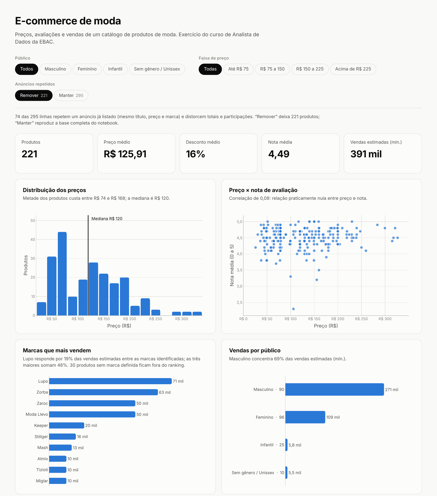
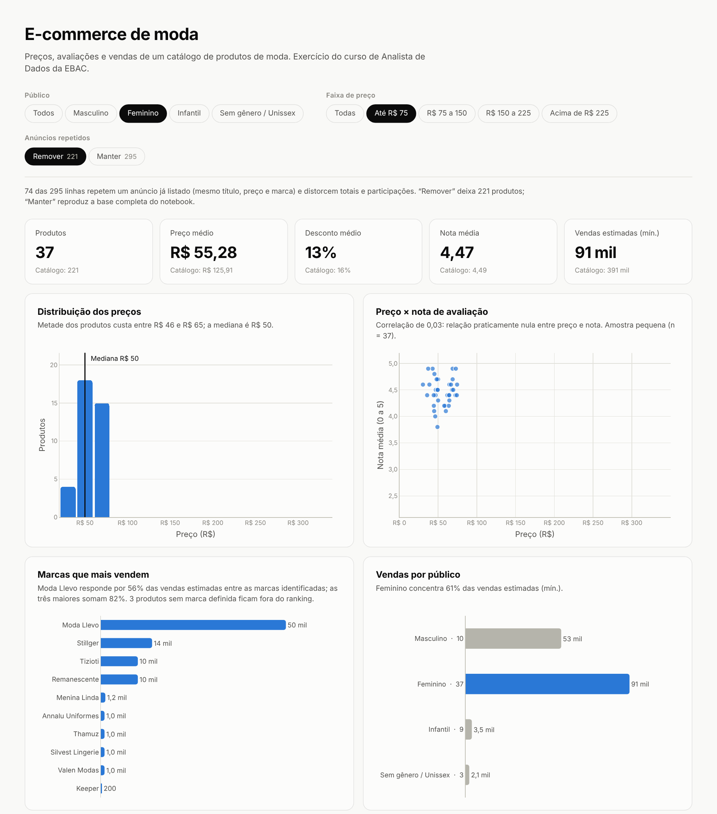
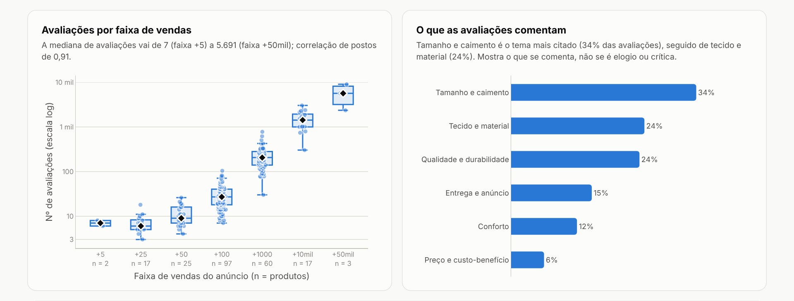

# Dashboard — E-commerce de moda

Versão interativa da análise do [notebook](../notebooks/01-visualizacao-ecommerce.ipynb), feita em Python com **Dash** e **Plotly**. A mesma base (`ecommerce_estatistica.csv`, 295 linhas), agora com filtros, indicadores no topo e uma frase de leitura sob cada gráfico.

**Conteúdo:** cinco indicadores (produtos, preço médio, desconto médio, nota média, vendas estimadas) · oito gráficos (histograma de preços, preço × nota, marcas que mais vendem, vendas por público, preço por público, mapa de correlação, avaliações por faixa de vendas, temas das avaliações) · tabela dos dez produtos que mais vendem.

**Filtros:** público, faixa de preço e anúncios repetidos (remover ou manter). Todos os números e gráficos reagem aos mesmos filtros.



Os filtros mudam indicadores, gráficos e frases de leitura ao mesmo tempo. Abaixo, o público feminino na faixa de até R$ 75:



Mais abaixo na página, o boxplot de avaliações por faixa de vendas (escala logarítmica) e os temas citados nas avaliações:



## Como rodar

```bash
pip install -r requirements.txt
python app.py
```

Abra `http://127.0.0.1:8050`. Na versão Dash a faixa de preço é um controle deslizante.

## Versão em HTML

```bash
python exportar_html.py              # dashboard.html, ~1,4 MB, carrega o Plotly de um CDN
python exportar_html.py --offline    # dashboard.html com o Plotly embutido, ~6,2 MB
```

É um arquivo único que abre no navegador, sem Python e sem servidor. Como não há servidor, o script calcula antes todas as combinações de filtro e embute o resultado na página (gráficos iguais são guardados uma vez só). Por isso, no HTML a faixa de preço são cinco faixas fixas (todas, até R$ 75, R$ 75 a 150, R$ 150 a 225 e acima de R$ 225), em vez do controle deslizante.

## Estrutura

| Arquivo | Função |
|---|---|
| `dados.py` | Leitura do CSV, padronização de público e marca, temas das avaliações, filtros, indicadores e formatação em pt-BR |
| `graficos.py` | As oito figuras em Plotly, as frases de leitura e a tabela |
| `app.py` | Layout e callbacks do Dash |
| `exportar_html.py` | Gera o HTML estático a partir das mesmas funções |
| `assets/estilo.css` | Estilo único, usado pelo Dash e embutido no HTML |
| `imagens/` | Capturas de tela usadas neste README |

## Decisões sobre os dados

**Público.** O cadastro tem nove valores de gênero. Agrupei em quatro: masculino, feminino, infantil (meninos, meninas, bebês e infantil sem gênero) e sem gênero / unissex. Quando o cadastro não diz o gênero (ou traz um texto solto), o título decide, mas só se for inequívoco. Isso reclassificou 4 linhas.

**Marca.** O cadastro tem 108 grafias; depois da padronização ficam 81. Juntei variações do mesmo nome (ex.: “Stillger Jeans” e “Stillger”) e tratei como *Sem marca definida* campos que não são marca (“própria”, “genérica”, “não definido” ou uma descrição de produto). Essas linhas continuam nos totais, mas ficam fora do ranking de marcas. As regras estão em `dados.py` (`MARCA_EQUIVALENTE`, `NAO_E_MARCA`) e são decisões minhas: vale revisar.

**Temas das avaliações.** Cada produto traz três avaliações. O dashboard procura palavras-chave (tamanho, tecido, qualidade, conforto, preço, entrega) e conta em quantas das avaliações cada tema aparece. É contagem de palavras, não um modelo de linguagem, e mostra **o que se comenta**, não se é elogio ou crítica.

**Avaliações por faixa de vendas.** O gráfico é um boxplot em escala logarítmica, um por faixa de vendas. A escala log abre a faixa inicial e deixa visível que a mediana de avaliações cresce muito de uma faixa para a seguinte. Isso é uma relação de potência (linear em log-log), não exponencial.

## O que muda ao remover os anúncios repetidos

Ao montar o dashboard, notei que 74 das 295 linhas repetem outra: mesmo título, preço e marca, com contagem de avaliações quase idêntica (um mesmo anúncio coletado mais de uma vez). Como não tenho como confirmar a origem na base, tratei como repetição e deixei **as duas visões à escolha**. “Remover” é o padrão; “Manter” reproduz a base completa do notebook.

| | Manter (295) | Remover (221) |
|---|---:|---:|
| Vendas estimadas (mín.) | 869 mil | 391 mil |
| Marca líder em vendas | Zorba, 31% | Lupo, 19% |
| Três maiores marcas | 62% | 48% |

(Participações calculadas entre as marcas identificadas.) A regra de repetição (título + preço + marca) é conservadora: o mesmo título com preço diferente continua como produtos distintos.

## Limites

- **Vendas** vêm em faixas, então os totais são um mínimo e os gráficos de vendas formam degraus.
- **Desconto** foi lido como percentual; a base não traz a unidade.
- Os gráficos descrevem associações na base, não relações de causa. Com poucos produtos (ex.: o público infantil, 25), a frase de leitura avisa que a amostra é pequena.
- A padronização de marca e a classificação de temas são regras simples e imperfeitas.
- Só há tema claro.

## Dados

`ecommerce_estatistica.csv`, a mesma base dos exercícios anteriores do curso (as colunas `_Cod`, `_Freq` e `_MinMax` vêm dessas etapas), em [`../data/`](../data/).
